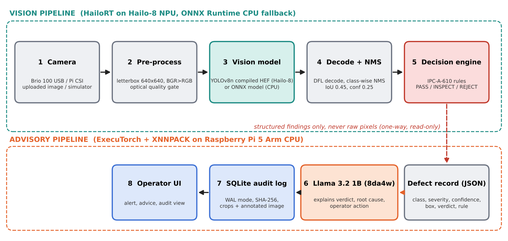
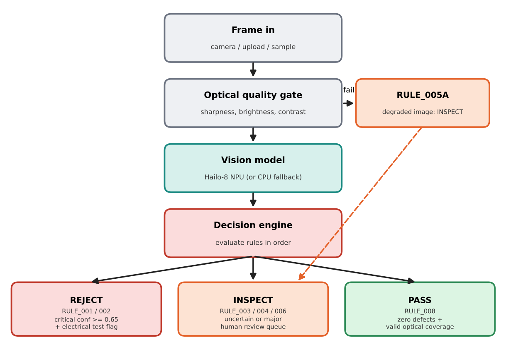
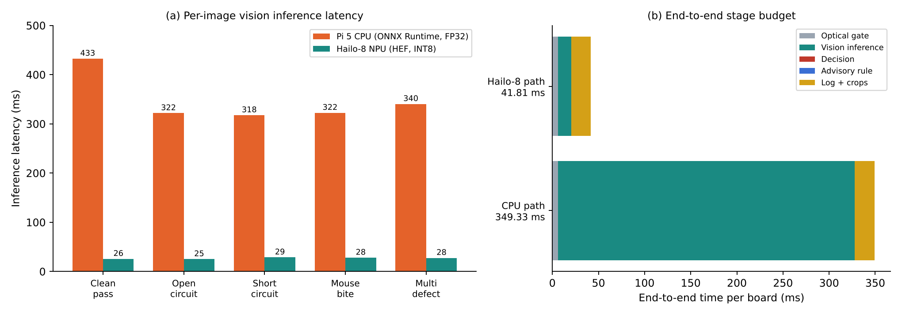
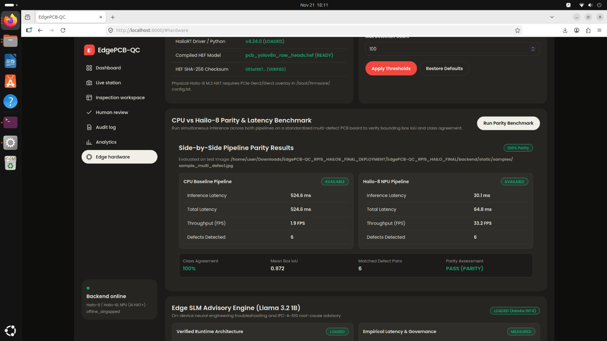
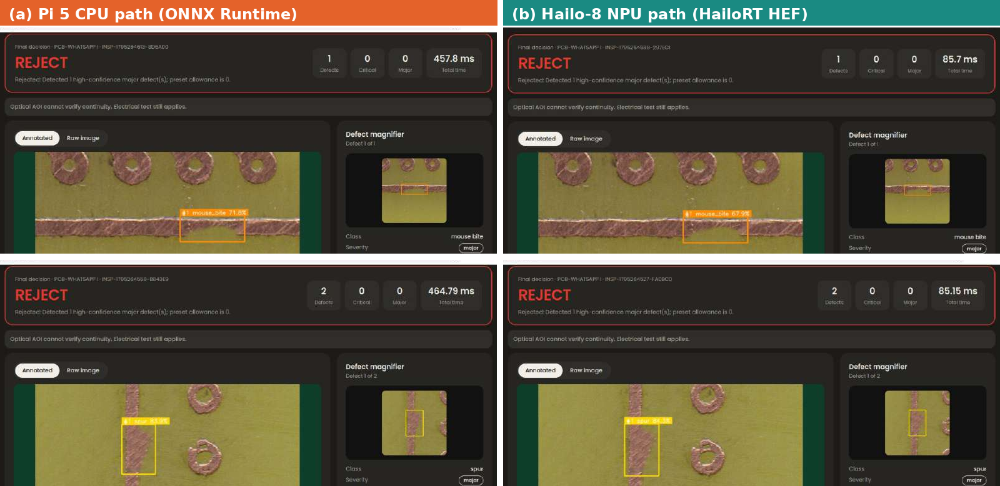
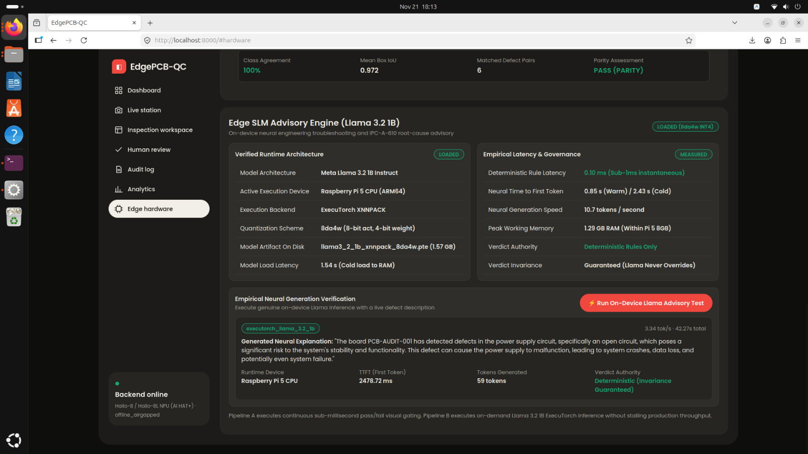
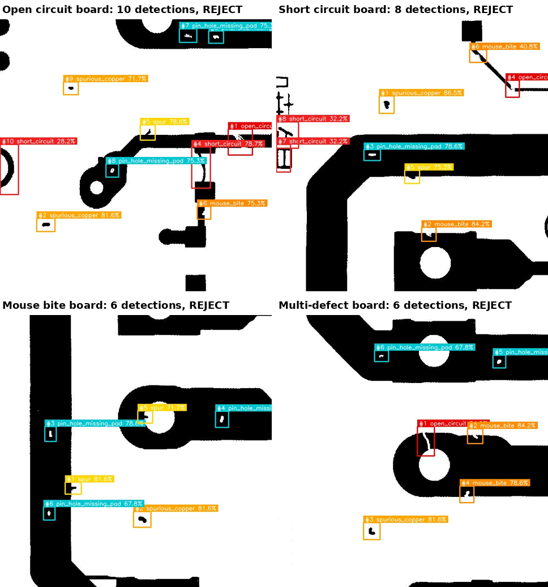
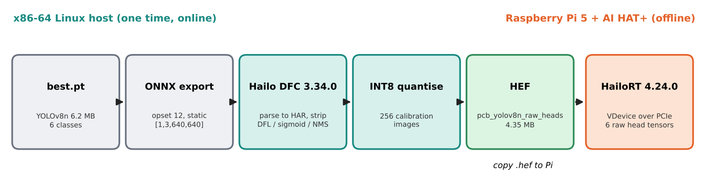

<div align="center">

# EdgePCB-QC

### Offline Edge-AI Quality Inspector for Printed Circuit Boards
**Detect · Classify · Alert · Log: all on-device, no cloud**

Raspberry Pi 5 + Hailo-8 NPU (YOLOv8n) &nbsp;|&nbsp; Llama 3.2 1B via ExecuTorch &nbsp;|&nbsp; IPC-A-610 decision engine


</div>

> **Bharat AI-SoC Challenge 2026-27, Problem Statement 5:** Real-Time Industrial Defect Detection and Quality-Control Assistant.
> Built by **Vishnu Varman V** and **Sai Darshini M**, St. Joseph's College of Engineering, Chennai.

---

## What it does

EdgePCB-QC inspects **bare PCBs** and tells the operator what is wrong, how serious it is and what to do next, entirely on a Raspberry Pi 5.

1. **Detect** six PCB defect types with a YOLOv8n detector compiled to a **Hailo-8 HEF** (ONNX Runtime CPU fallback).
2. **Classify** each defect with a severity (High / Medium / Low) and decide **PASS / INSPECT / REJECT** with a **deterministic IPC-A-610 rule engine**.
3. **Alert** the operator with plain-language advice from **Llama 3.2 1B (8da4w)** running through **ExecuTorch** on the Arm CPU.
4. **Log** every inspection to a local SQLite database with crops, an annotated image and a SHA-256 of the source frame.
5. **Run at the edge**: detection, advice and logging are fully local. The demo works with the network disabled.

| Defect class | Severity | Electrical test |
|---|---|---|
| `open_circuit` | High | Mandatory |
| `short_circuit` | High | Mandatory |
| `pin_hole_missing_pad` | High | n/a |
| `mouse_bite` | Medium | n/a |
| `spur` | Medium | n/a |
| `spurious_copper` | Medium | n/a |

---

## Architecture: two separate runtimes

<p align="center"></p>

| | Vision pipeline | Advisory pipeline |
|---|---|---|
| **Runtime** | HailoRT 4.24.0 (HEF) / ONNX Runtime 1.20 | ExecuTorch 1.6.0 + XNNPACK |
| **Runs on** | Hailo-8 NPU (CPU fallback) | Raspberry Pi 5 Arm CPU |
| **Model** | YOLOv8n, 6 classes, INT8 HEF (4.35 MB) | Llama 3.2 1B Instruct, 8da4w (1.57 GiB) |
| **Job** | Detect, classify, localise | Explain, advise, write log text |
| **Authority over verdict** | Evidence only | **None** (read-only) |

**The language model never decides pass or fail.** The rule engine produces the verdict and a structured JSON record; Llama receives it as read-only input and only explains it.

```json
{ "verdict": "REJECT",
  "rule": "RULE_001_HIGH_CONF_CRITICAL_DEFECT",
  "requires_electrical_test": true,
  "defects": [ { "class": "open_circuit", "severity": "critical",
                 "confidence": 0.918, "bbox": [537, 258, 594, 319] } ] }
```

### Decision logic

<p align="center"></p>

| Rule | Condition | Verdict |
|---|---|---|
| `RULE_005A` | Blurry, under- or over-exposed frame | INSPECT (never PASS) |
| `RULE_001` | Critical defect, confidence ≥ 0.65 | REJECT + electrical-test flag |
| `RULE_002` | Major defects exceed preset allowance | REJECT |
| `RULE_003` | Critical defect, low confidence | INSPECT |
| `RULE_004/006` | Major defect or minor excess | INSPECT |
| `RULE_008` | Zero defects, valid optical coverage | PASS |

Two presets: **Consumer (IPC-A-610 Class 2)** and **High-reliability (Class 3)**.

---

## Results (Raspberry Pi 5, 16 GB, AI HAT+, offline)

### Detector quality
Trained on **12,016 images** from DeepPCB, DsPCBSD+ and PCB-Defect V2 with **zero-leakage splits** (by board group / board serial, verified with SHA-256).

| mAP@0.50 | mAP@0.50:0.95 | Precision | Recall |
|:---:|:---:|:---:|:---:|
| **80.02%** | 48.76% | 76.00% | 75.25% |

Recall on critical classes: `pin_hole_missing_pad` 96.0%, `open_circuit` 86.3%, `short_circuit` 82.4%.

### CPU vs Hailo-8 speed

<p align="center"></p>

| Board | Pi 5 CPU | Hailo-8 | Speed-up |
|---|---|---|---|
| clean_pass | 432.53 ms (2.3 FPS) | 25.58 ms (39.1 FPS) | 16.9x |
| open_circuit | 321.76 ms (3.1 FPS) | 25.06 ms (39.9 FPS) | 12.8x |
| short_circuit | 317.61 ms (3.1 FPS) | 28.68 ms (34.9 FPS) | 11.1x |
| mouse_bite | 322.49 ms (3.1 FPS) | 28.06 ms (35.6 FPS) | 11.5x |
| multi_defect | 340.36 ms (2.9 FPS) | 27.61 ms (36.2 FPS) | 12.3x |

- **Full inspection cycle** (optical gate, inference, decision, logging): **41.81 ms** on Hailo-8 vs **349.33 ms** on CPU.
- **Host CPU load:** 14-33% (Hailo-8) vs 380-395% (CPU). **SoC temperature:** 42.5-46.9 °C vs 64.8-71.2 °C.
- **Agreement:** CPU (FP32) and Hailo-8 (INT8) match on critical classes, mean box IoU 0.961-0.972.

<p align="center"></p>
<p align="center"></p>

### On-device Llama advisory (ExecuTorch, Pi 5 CPU)
Live run: TTFT 2.48 s, 3.34 tokens/s. A deterministic rule-based advisory (0.10 ms) is shown instantly; the neural explanation is generated on demand and never blocks the verdict.

<p align="center"></p>

### Example detections

<p align="center"></p>

---

## Hailo model flow

The detector is compiled **once on an x86-64 Linux host**; the Pi only runs the compiled `.hef`.

<p align="center"></p>

`best.pt` → ONNX (opset 12, static 640x640) → Hailo Dataflow Compiler 3.34.0 (INT8, 256 calibration images) → `pcb_yolov8n_raw_heads.hef` → HailoRT 4.24.0 on the Pi. DFL decoding and NMS run on the host CPU.

---

## Repository layout

> Adjust to match your tree.

```
EdgePCB-QC/
├── backend/                 FastAPI REST backend and web station server
├── frontend/                React 18 / TypeScript / Vite industrial station UI
├── hardware/
│   ├── inference/           HailoRT NPU wrapper, ONNX CPU fallback, DFL decoder
│   ├── camera/              CSI (Picamera2) & USB (OpenCV) camera drivers
│   └── system/              PCIe, Hailo device telemetry & thermal monitor
├── decision_engine/         Deterministic IPC-A-610 decision rules & presets
├── advisory/                Llama 3.2 1B ExecuTorch runtime & deterministic SOP fallback
├── database/                SQLite inspection ledger with SHA-256 tamper evidence
├── models/
│   ├── hailo/               pcb_yolov8n_raw_heads.hef (4.35 MB Hailo-8 binary)
│   ├── onnx/                pcb_multidomain_yolov8n_640.onnx (12.19 MB CPU fallback)
│   └── llama/               tokenizer.model (2.08 MB) [weights via Meta License]
├── tests/                   validate_system.py, regression and integration test suite
├── docs/                    Research paper, technical reports, deployment guides
│   └── images/              Architecture, decision flow, latency & UI figures
├── START_EDGEPCB_QC.sh      Production launch script
└── STOP_EDGEPCB_QC.sh       Station shutdown script
```

---

## Quick start

### Requirements
- Raspberry Pi 5 (8 GB minimum, 16 GB used for measurements) with **Raspberry Pi AI HAT+ (Hailo-8)**
- Ubuntu 26.04 LTS (aarch64), Python 3.12+
- HailoRT 4.24.0 + PCIe Gen2/3 enabled (`/boot/firmware/config.txt`)
- A USB webcam (tested: Logitech Brio 100) or Pi CSI camera (tested: OV5647 Rev 1.3)

### Run

```bash
git clone https://github.com/vishnuv41/EdgePCB-QC.git
cd EdgePCB-QC

# place the model files under models/ (see "Model files" below)

./START_EDGEPCB_QC.sh --daemon      # start the station
# open http://localhost:8000  (or http://<PI_IP>:8000 on your network)

./STOP_EDGEPCB_QC.sh                # stop
```

Without the AI HAT the app falls back to ONNX Runtime on the CPU automatically.

### Verify the install

```bash
.venv/bin/python3 tests/validate_system.py     # 7-layer end-to-end validation
```

Compare CPU and Hailo-8 on a sample through the API:

```bash
curl -s -X POST http://127.0.0.1:8000/api/v1/inference/compare \
  -H "Content-Type: application/json" \
  -d '{"sample_filename": "sample_open_circuit.jpg"}' | jq .
```

### Model files
Large model files should not live in plain Git history. Use **Git LFS** or a release download:

| File | Size | SHA-256 prefix |
|---|---|---|
| `models/hailo/pcb_yolov8n_raw_heads.hef` | 4.35 MB | `053a1967ad` |
| `models/onnx/pcb_multidomain_yolov8n_640.onnx` | 12.19 MB | `0f219cae19` |
| `models/llama/llama3_2_1b_xnnpack_8da4w.pte` | 1.57 GiB | `2de22a4665` |
| `models/llama/tokenizer.model` | 2.08 MB | `82e9d31979` |

Llama 3.2 is released by Meta under its own community licence; download the weights and tokenizer from Meta and follow their terms.

---

## Dashboard

- **Live station:** camera selector (Brio 100 / Pi CSI / upload / simulator), live FPS and focus badge, curated test boards
- **Inspection workspace:** verdict banner with the rule that fired, annotated and raw views, defect magnifier
- **Human review:** INSPECT boards queue for an operator decision
- **Audit log and analytics:** every inspection, with crops and SHA-256
- **Edge hardware:** HailoRT status, HEF checksum, CPU vs Hailo parity benchmark, Llama engine

---

## Fully offline

No cloud inference, no CDN, no telemetry. Internet is used only to train models and download packages and weights. Run the demo with the network disabled to confirm.

---

## Known limits and roadmap

- **Phase 1 camera:** a consumer USB webcam and a Pi CSI camera on a bench jig. Phase 2 adds a higher-resolution autofocus camera, fixed mount and controlled lighting, plus tiled capture for small defects.
- Optical inspection sees surface defects only; open and short detections always flag a mandatory electrical test.
- Neural Llama advice takes tens of seconds on the Pi CPU, so it runs on demand while the deterministic advisory is instant.

---

## Documentation

- Full technical report: `docs/EdgePCB-QC_Technical_Report.docx`
- Challenge: Bharat AI-SoC Challenge 2026-27, PS5

## Acknowledgements

Ultralytics YOLOv8, Hailo (HailoRT and Dataflow Compiler), PyTorch ExecuTorch and XNNPACK, Meta Llama 3.2, and the DeepPCB, DsPCBSD+ and PCB-Defect V2 datasets.

## License

This project is open-source under the [MIT License](LICENSE).

### Third-Party Licenses & Attributions
- **Ultralytics YOLOv8**: AGPL-3.0 / Enterprise.
- **Meta Llama 3.2**: Licensed under the [Llama 3.2 Community License](https://www.llama.com/llama3/license/). Built with Meta Llama 3.2.
- **HailoRT & Dataflow Compiler**: Copyright (c) Hailo Technologies Ltd.
- **Datasets**: DeepPCB, DsPCBSD+, and PCB-Defect V2 remain under their respective academic and research open-source licenses.
