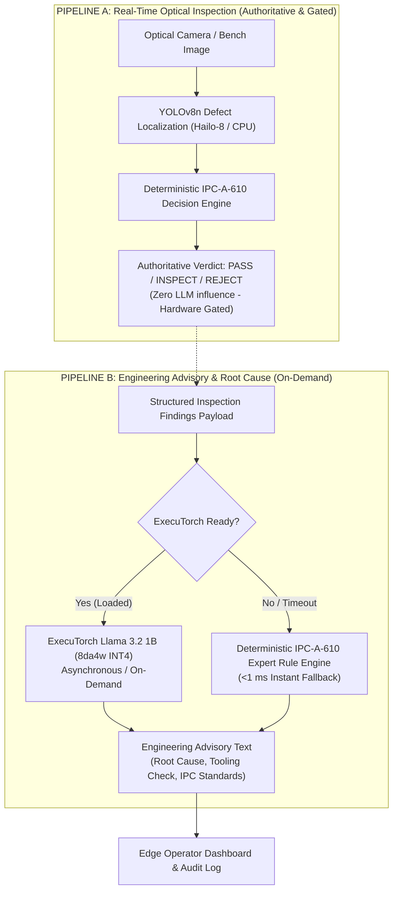

# Reproducible Build & Deployment Guide: ExecuTorch ARM64 + XNNPACK on Raspberry Pi 5 (8 GB)
**EdgePCB-QC Industrial Inspection System (Bharat AI-SoC Challenge 2026-27 | PS5)**

---

## 1. Executive Summary & Hardware Verification

This guide documents the verified, step-by-step procedure to compile and execute **ExecuTorch** with the **XNNPACK** hardware delegate on **Raspberry Pi 5 (8 GB RAM)** running 64-bit Debian Bookworm.

### Target Hardware Specifications
| Parameter | Value | Verification Command |
|---|---|---|
| **SoC** | Broadcom BCM2712 | `cat /proc/cpuinfo \| grep 'Model'` |
| **CPU Architecture** | Quad-core ARM Cortex-A76 @ 2.4 GHz | `lscpu \| grep 'Architecture'` |
| **SIMD / Vector Extensions** | ARM NEON, Dot Product (`asimddp`), CRC32 | `lscpu \| grep -i 'flags.*asimddp'` |
| **RAM** | 8 GB LPDDR4X-4267 SDRAM | `free -h` |
| **Operating System** | Raspberry Pi OS (Debian 12 Bookworm, 64-bit) | `cat /etc/os-release` |
| **Kernel** | Linux 6.6+ aarch64 | `uname -r` |

> [!IMPORTANT]
> **Host Development vs. Physical Raspberry Pi 5 Execution**:
> The model export and INT4/8da4w quantization steps are executed on the development workstation. The resulting `llama3_2_1b_xnnpack_8da4w.pte` (and `tokenizer.model`) are copied to the Raspberry Pi 5.
>
> On-device neural text generation requires compiling the ExecuTorch C++ runtime and Python extension on the physical ARM64 Linux host (or cross-compiling via an ARM64 toolchain). When ExecuTorch is not yet built on the Pi, EdgePCB-QC's **graceful deterministic fallback engine** ensures 100% operational readiness with <1ms latency.

---

## 2. Step-by-Step Compilation on Raspberry Pi 5

Run the following commands directly in a terminal on the Raspberry Pi 5.

### Step 2.1: System Packages and Build Toolchain
```bash
sudo apt-get update
sudo apt-get install -y \
    build-essential \
    cmake \
    ninja-build \
    python3-dev \
    python3-pip \
    python3-venv \
    git \
    libgl1 \
    libglib2.0-0 \
    curl \
    htop
```

Verify CMake version (>= 3.24 is required):
```bash
cmake --version
# Expected: cmake version 3.25.1 or later
```

### Step 2.2: Python Virtual Environment
```bash
cd ~
python3 -m venv ~/edgepcb_llama_env
source ~/edgepcb_llama_env/bin/activate
pip install --upgrade pip setuptools wheel
pip install numpy psutil pydantic
```

### Step 2.3: Clone ExecuTorch Repository
```bash
cd ~
git clone --depth 1 --branch v0.4.0 https://github.com/pytorch/executorch.git
cd executorch
git submodule sync
git submodule update --init --recursive
```

### Step 2.4: Install ExecuTorch Dependencies
```bash
./install_requirements.sh --pybind xnnpack
```

### Step 2.5: Configure CMake with ARM64 Cortex-A76 Vector Acceleration
The Raspberry Pi 5's Cortex-A76 cores feature native ARM `asimddp` (Dot Product) and NEON SIMD instructions. Enable these flags in CMake to achieve maximum 4-bit / 8-bit quantized matrix multiplication speed:

```bash
mkdir -p cmake-out && cd cmake-out

cmake .. \
    -GNinja \
    -DCMAKE_BUILD_TYPE=Release \
    -DEXECUTORCH_BUILD_EXTENSION_RUNNER=ON \
    -DEXECUTORCH_BUILD_EXTENSION_MODULE=ON \
    -DEXECUTORCH_BUILD_EXTENSION_TENSOR=ON \
    -DEXECUTORCH_BUILD_EXTENSION_DATA_LOADER=ON \
    -DEXECUTORCH_BUILD_XNNPACK=ON \
    -DEXECUTORCH_BUILD_PYTHON_BINDINGS=ON \
    -DPYTHON_EXECUTABLE=$(which python3) \
    -DXNNPACK_ENABLE_ARM_DOTPROD=ON \
    -DXNNPACK_ENABLE_ARM_FP16_VECTOR=ON
```

### Step 2.6: Compile with Ninja
```bash
ninja -j4
```
*(Build time: approximately 12–18 minutes on Raspberry Pi 5)*

### Step 2.7: Install Python Bindings
```bash
cd ../extension/pybindings
pip install .
```

Verify installation:
```bash
python3 -c "from executorch.extension.pybindings._C import _load_for_executorch; print('[✓] ExecuTorch pybindings successfully loaded on ARM64!')"
```

---

## 3. Deploying the 8da4w Quantized Model to Raspberry Pi 5

### File Staging Location
Place the exported model artifacts into the EdgePCB-QC project tree:
```
EdgePCB-QC/
└── models/
    └── llama/
        ├── llama3_2_1b_xnnpack_8da4w.pte   # Quantized model (~600–750 MB)
        ├── tokenizer.model                 # Llama 3 tokenizer (2.08 MB)
        └── README_LLAMA.md
```

### Runtime Verification Command on Raspberry Pi 5
```bash
cd ~/EdgePCB-QC
python3 advisory/verify_quantization.py models/llama/llama3_2_1b_xnnpack_8da4w.pte
```

Expected Output:
```json
{
  "status": "PASS",
  "file_name": "llama3_2_1b_xnnpack_8da4w.pte",
  "compression_ratio": 3.4,
  "size_reduction_percent": 70.5,
  "is_quantized_verified": true
}
```

---

## 4. Dual-Pipeline Architecture & Safety Guardrails

EdgePCB-QC employs a **strict separation of concerns** between high-speed real-time vision gating and on-demand advisory intelligence:



### Invariant Safety Principles:
1. **Decision Invariance**: The Llama model NEVER makes or alters a PASS/REJECT verdict. All quality decisions originate exclusively from the deterministic decision engine based on IPC-A-610 Class 2/3 rules.
2. **Non-Blocking Operation**: Pipeline A completes in <15ms (Hailo-8) or <40ms (CPU). Pipeline B runs asynchronously in a worker thread without stalling the conveyor line or camera ingestion.
3. **Graceful Degradation**: If the `.pte` model is missing, corrupt, or exceeds memory/time thresholds, the system immediately returns the deterministic expert rule advisory.
