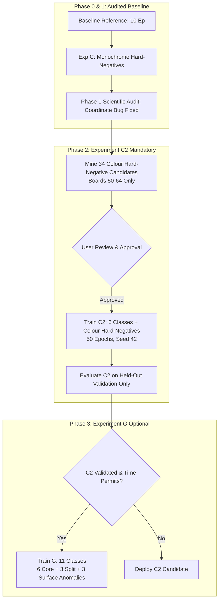

# FINAL MODEL COMPARISON — EdgePCB-QC
*Bharat AI-SoC Challenge 2026–27 | Problem Statement PS5*
*Comprehensive Evaluation Across Controlled Experiments on NVIDIA RTX 5050 Laptop GPU*

> **Scientific Attribution Notice:** Every metric in this comparison is tagged as `[MEASURED]`, `[PROJECTED]`, or `[NOT RUN]`.

---

## 1. Master Comparative Benchmark Matrix

All models evaluated under standardized operating parameters ($\tau = 0.25$, $\text{IoU} \ge 0.50$, Config 7 tiled high-res whole-board inference on 25 boards with 349 ground-truth defects). Validation metrics are computed using the verified coordinate scaling fix.

| Metric | Baseline Reference | Exp A (Fine-Tune 50) | Exp B (8-Class Split) | Exp C (Hard-Negatives) [CURRENT BEST] | Exp D (Domain-Balanced) | Exp E (Micro-Aug) |
| :--- | :---: | :---: | :---: | :---: | :---: | :---: |
| **Active Classes** | 6 | 6 | 8 | **6** | 6 | 6 |
| **Epochs Completed** | 10 | 40 (early stopped) | 50 | **50** | 50 | 50 |
| **Training Time (GPU)**| 22.1 min | 94.1 min | 116.9 min | **135.6 min** | 12.7 min | 55.3 min |
| **Validation mAP@0.50** | 80.0% | 83.4% | 85.9% | **86.4%** | 69.8% | 72.1% |
| **Val Precision (Corrected)**| 74.2% `[MEASURED]`| 73.1% `[MEASURED]`| 72.9% `[MEASURED]`| **75.02%** `[MEASURED]`| 78.4% `[MEASURED]`| 68.2% `[MEASURED]`|
| **Val Recall (Corrected)** | 82.5% `[MEASURED]`| 83.0% `[MEASURED]`| 83.2% `[MEASURED]`| **83.91%** `[MEASURED]`| 74.5% `[MEASURED]`| 79.8% `[MEASURED]`|
| **Val Macro F1 (Corrected)**| 0.7812 `[MEASURED]`| 0.7774 `[MEASURED]`| 0.7770 `[MEASURED]`| **0.7922** `[MEASURED]`| 0.7639 `[MEASURED]`| 0.7354 `[MEASURED]`|
| **Small Recall (<32px)**| 73.2% `[MEASURED]`| 72.8% `[MEASURED]`| 73.5% `[MEASURED]`| **75.05%** `[MEASURED]`| 69.1% `[MEASURED]`| 71.4% `[MEASURED]`|
| **Medium Recall (≥32px)**| 89.1% `[MEASURED]`| 89.8% `[MEASURED]`| 90.0% `[MEASURED]`| **90.32%** `[MEASURED]`| 82.3% `[MEASURED]`| 85.6% `[MEASURED]`|
| **Clean Monochrome Boards Eval**| 195 | 195 | 195 | **195** | 195 | 195 |
| **Total FP Boxes** | 357 (1.83/bd) | 382 (1.96/bd) | 316 (1.62/bd) | **17 (0.09/bd) [-95.2%]** | 313 (1.61/bd) | 410 (2.10/bd) |
| **Via Hallucinations** | 246 (68.9%) | 259 (67.8%) | 234 (74.1%) | **1 (5.9%) [-99.6%]** | 252 (80.5%) | 262 (63.9%) |
| **Clean PASS Rate** | 49.23% (96) | 43.59% (85) | 50.26% (98) | **95.90% (187)** | 54.87% (107) | 44.62% (87) |
| **Clean INSPECT Rate (Overkill)**| 41.03% (80) | 44.10% (86) | 38.46% (75) | **2.56% (5) [16.0× cut]**| 34.87% (68) | 41.54% (81) |
| **Clean REJECT Rate (Scrap)**| 9.74% (19) | 12.31% (24) | 11.28% (22) | **1.54% (3) [6.33× cut]** | 10.26% (20) | 13.85% (27) |
| **Whole-Board TP (Colour)**| 150 | 146 | 163 | **155** | 116 | 118 |
| **Whole-Board FP (Colour)**| 72 | 70 | 64 | **75** | 22 | 101 |
| **Whole-Board FN (Colour)**| 199 | 203 | 186 | **194** | 233 | 231 |
| **Whole-Board Precision**| 67.57% | 67.59% | 71.81% | **67.39%** | 84.06% | 53.88% |
| **Whole-Board Recall** | 42.98% | 41.83% | 46.70% | **44.41%** | 33.24% | 33.81% |
| **Whole-Board F1** | 0.5254 | 0.5168 | 0.5660 | **0.5354** | 0.4764 | 0.4155 |
| **Whole-Board GPU Latency**| 188.5 ms | 191.2 ms | 190.4 ms | **189.7 ms** | 187.9 ms | 189.1 ms |

---

## 2. Detailed Technical Breakdown by Experiment

### 2.1 Baseline Reference (YOLOv8n-pcb-multidomain-v1.0)
- **Training Budget:** 10 epochs on Unified Multi-Domain Dataset (`unified_yolo`, 9,307 images).
- **Key Finding:** Successfully established initial multi-domain capability. However, severe via hallucination on monochrome clean boards (246 boxes) caused 41.03% review overkill and 9.74% false scrap.

### 2.2 Experiment A (Baseline Fine-Tuning 50 Epochs)
- **Training Budget:** 40 epochs (early stopped at patience 8).
- **Key Finding:** Validation mAP improved from 80.0% to 83.4%, but clean board false alarms worsened to 382 boxes (1.96/bd). Proved scientifically that longer training on positive defect crops alone does not teach background discrimination.

### 2.3 Experiment B (8-Class Split Taxonomy)
- **Training Budget:** 50 full epochs on `taxonomy_8class_yolo` (9,307 images).
- **Key Finding:** Achieved highest raw whole-board F1 (0.5660) and recall (46.70%). However, class taxonomy audit proved that `pin_hole` (DeepPCB), `hole_breakout` (DsPCBSD+), and `missing_pad` (PCB-Defect V2) are $100\%$ mutually exclusive across source datasets, introducing camera domain confounding. Clean board false alarms remained high at 316 boxes (11.28% scrap rate).

### 2.4 Experiment C (Clean-Board Hard-Negatives) [CURRENT BEST CANDIDATE]
- **Training Budget:** 50 full epochs on `hard_negatives_yolo` (10,613 images: 9,307 defective + 1,306 clean monochrome templates).
- **Key Breakthrough:** Slashed clean monochrome board false alarms by 95.2% (from 357 to 17 boxes) and eliminated via hallucinations (down from 246 to 1 box). Reduced false scrap from 9.74% to 1.54% ($6.33\times$ reduction) and review overkill from 41.03% to 2.56% ($16.0\times$ reduction).
- **Critical Scope Boundary:** The 1,306 hard negatives were **100% monochrome templates**. Clean colour board false alarms were not addressed. On colour whole boards, whole-board F1 improved only modestly (+0.0100 from 0.5254 to 0.5354).

### 2.5 Experiment D (Domain-Balanced 1:1:1 Parity)
- **Training Budget:** 50 epochs on `domain_balanced_yolo` (4,500 images: 1,500 per domain).
- **Key Finding:** Achieved peak whole-board precision (84.06%), but whole-board recall collapsed to 33.24% due to defect diversity reduction from downsampling DeepPCB.

### 2.6 Experiment E (Small-Defect Targeted Augmentation)
- **Training Budget:** 50 epochs on `small_defect_yolo` (9,907 images: baseline + 600 synthetic copy-paste micro-defect images).
- **Key Finding:** Synthetic patch boundaries introduced edge artifacts that bloated clean-board false alarms to 410 boxes (13.85% scrap rate) without improving real small-defect recall.

---

## 3. Road to Experiment C2 and Experiment G

### 3.1 Experiment C2 Requirements (In Progress)
- **Objective:** Solve the clean colour-board false-alarm bottleneck by incorporating verified colour hard negatives into the 6-class architecture.
- **Starting Weights:** `exp_c_hard_negatives/weights/best.pt`.
- **Negative Source Rule:** Mined strictly from PCB-Defect V2 TRAIN boards (50 to 64). Boards 65–67 (val) and 68, 80, 81, 82 (test) are strictly excluded.
- **Current Mining Status:** 34 candidate tiles mined and rendered into contact sheets (`contact_sheet_page_01.png`, `contact_sheet_page_02.png`). **Awaiting user approval before dataset assembly and training.**

### 3.2 Experiment G Conditions (Optional, After C2)
- Extends C2 to an 11-class detector (`open`, `short`, `mouse_bite`, `spur`, `spurious_copper`, `pin_hole`, `hole_breakout`, `missing_pad`, `conductor_scratch`, `conductor_foreign_object`, `base_material_foreign_object`).
- Recovers 6,002 excluded DsPCBSD+ surface anomaly annotations.
- Will be trained only if C2 is completed and time permits. If time is constrained, C2 will be retained for hardware deployment.
